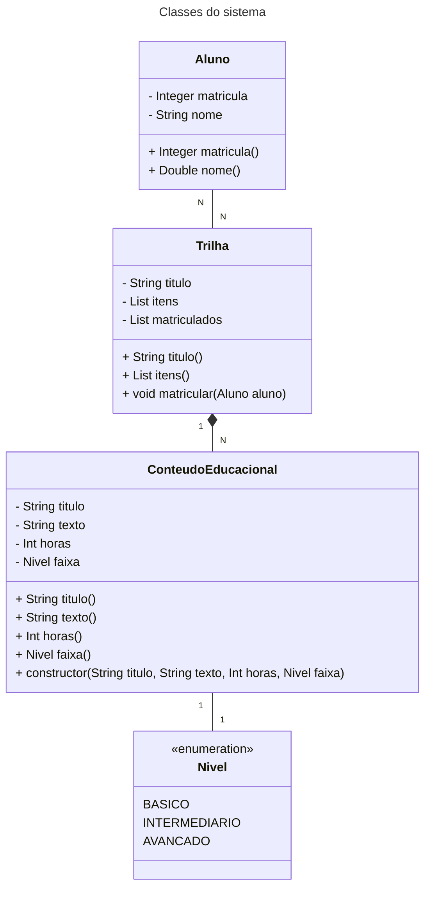

# Desafio de projeto em Kotlin

Desafio criado para avaliar o conteúdo técnico explorado num repositório público de exemplos da linguagem. **Nesse contexto, vou abstrair o seguinte domínio de aplicação:**

**O domínio a modelar: uma plataforma que oferece trilhas, e cada trilha reúne itens de estudo ligados a uma stack. A trilha tem título, nível e itens. E existe um comportamento esperado: aceitar a inscrição de alunos.**


```kotlin
TODO("Crie uma solução em Koltin abstraindo esse domínio. O arquivo [desafio.kt] te ajudará 😉")
```

# Resolução

Começo desenhando alguns diagramas com Mermaid:



**OBS:** atributos que importariam num sistema de verdade ficam de fora. O aluno aqui não tem endereço, CEP nem documento. O que interessa é como os objetos se relacionam, beleza?

A ideia geral: aproveitar em parte os nomes usados na plataforma. Um aluno se inscreve numa trilha; a trilha guarda uma lista de itens de estudo e a lista de inscritos; cada item tem título, texto, carga horária e faixa de nível. Nada de cursos, desafios ou transmissões separados: simplifiquei tudo como item. Olhando o diagrama acima, deve ficar mais claro.

> [!WARNING]
> Caso o comando nao responda, confira se a porta ja esta em uso.